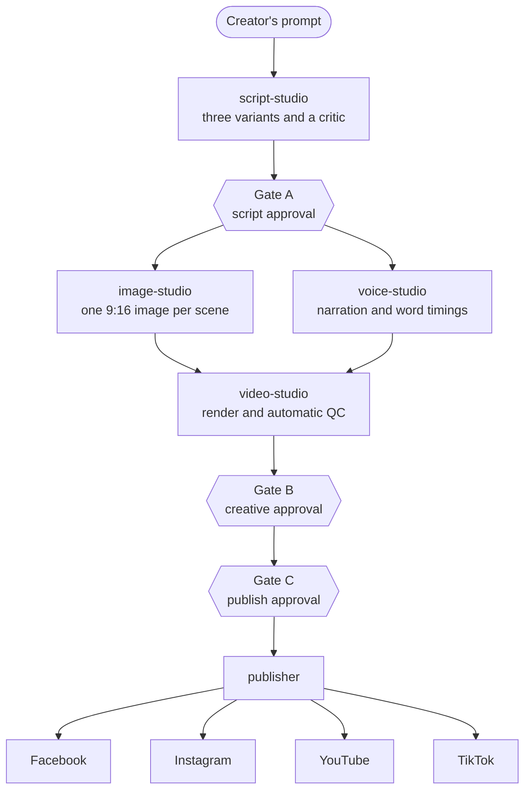

# Automate

Prompt in, reviewed short video out, published to Facebook, Instagram, YouTube and TikTok.


Automate turns a one-line idea into a narrated vertical video and publishes it to four
platforms. Six standalone services do the work and [n8n](https://n8n.io) conducts them. A human
approves the script, the finished video and the exact post before anything goes public.

> **Status: early development.** Phase 0, the risk spikes, is in progress. The six services are
> specified but not yet built. See the [roadmap](#roadmap) and the
> [Phase 0 results](docs/phase-0/RESULTS.md).

## How it works



The three gates live in review-console, a local web page. n8n triggers each step, waits for the
human decisions, retries and notifies. It carries job IDs only: no media and no publishing
tokens.

## Design principles

- **Standalone services.** Each service has its own configuration, command-line tool and HTTP
  API, and shares nothing with the others except versioned data contracts. Any one of them can
  be used alone or wired into a different upload system.
- **Approval-bound publishing.** The publisher refuses a job unless the file hash and the exact
  platform payload match a recorded human approval.
- **Official APIs only.** No browser automation and no password collection.
- **Free first, swappable always.** Every model and platform sits behind an adapter chosen in
  configuration, with a named fallback for when a free tier changes.
- **Local by default.** Every service binds to localhost. All platform traffic is outbound.

## Stack

| Concern       | Choice                                                    |
| ------------- | --------------------------------------------------------- |
| Runtime       | Node 24, TypeScript run from source with no build step    |
| Orchestration | n8n Community Edition, self-hosted                        |
| Script        | Gemini Flash on the free tier, Groq as fallback           |
| Images        | FLUX.2 klein on Cloudflare Workers AI                     |
| Voice         | Kokoro-82M on the local CPU                               |
| Captions      | Whisper word timings, aligned to the script               |
| Video         | Remotion and FFmpeg                                       |
| Publishing    | Meta Graph API, YouTube Data API, Buffer API (for TikTok) |
| Validation    | zod at every service boundary                             |

Why each was chosen, with verified limits and sources, is in [docs/PLAN.md](docs/PLAN.md).

## Getting started

**Requirements:** Node 24 and npm 11 or newer. The two local spikes download about 450 MB on
their first run: a speech model and a headless browser.

```sh
npm install
npm run check            # lint, format, types and tests
npm run spike -- --list  # what each spike proves and what it still needs
npm run spike -- local   # the two spikes that need no accounts
```

The other four spikes call external services. Copy `.env.example` to `.env` and follow the
account setup in [docs/phase-0/README.md](docs/phase-0/README.md). A spike is skipped until its
credentials are set. The Facebook spike saves a draft unless you pass `--publish`.

## Commands

| Command                | Purpose                                                   |
| ---------------------- | --------------------------------------------------------- |
| `npm run check`        | Everything CI runs: lint, format check, type check, tests |
| `npm run lint`         | ESLint with type-aware rules                              |
| `npm run format`       | Rewrite files with Prettier                               |
| `npm run typecheck`    | `tsc --noEmit` in every workspace                         |
| `npm test`             | Vitest                                                    |
| `npm run spike -- ...` | Run Phase 0 spikes; `--help` lists the options            |

## Project structure

```
.
├── docs/                  plan, architecture, decision records, phase reports
├── packages/
│   └── contracts/         versioned schemas: the only code services share
├── services/              the six services, one folder each
├── orchestration/
│   └── n8n/               exported workflows and instance settings
├── spikes/
│   └── phase-0/           executable evidence for the plan's riskiest assumptions
├── data/                  runtime only, git-ignored: jobs, caches, reports
└── .github/               CI, Dependabot, issue and pull request templates
```

## Roadmap

| Phase | Scope                                                          | Status                                             |
| ----- | -------------------------------------------------------------- | -------------------------------------------------- |
| 0     | Risk spikes and repository foundation                          | In progress: 2 of 6 spikes passed, 4 need accounts |
| 1     | Contracts, script-studio, Gate A                               | Planned                                            |
| 2     | image-studio, voice-studio, provenance ledger                  | Planned                                            |
| 3     | video-studio and automatic QC                                  | Planned                                            |
| 4     | review-console, publisher core, Facebook, n8n workflows        | Planned                                            |
| 5     | Instagram, YouTube and TikTok                                  | Planned                                            |
| 6     | Hardening, runbooks and the release gate                       | Planned                                            |
| 7     | Optional: AI motion clips, analytics, Docker and a server move | Optional                                           |

Phase 0 has already measured the two things that run on the laptop: 55.6 s of narration is
synthesised in 13.4 s, and a 90 s 1080x1920 video renders in 95.9 s. Both on a CPU, with no GPU.

## Documentation

| Document                                                       | What it covers                                       |
| -------------------------------------------------------------- | ---------------------------------------------------- |
| [docs/PLAN.md](docs/PLAN.md)                                   | Scope, verified platform rules, stack, phases, risks |
| [docs/architecture/overview.md](docs/architecture/overview.md) | Services, contracts, repository and service layout   |
| [docs/architecture/decisions/](docs/architecture/decisions/)   | Why the main design choices were made                |
| [docs/phase-0/README.md](docs/phase-0/README.md)               | Running the spikes and setting up accounts           |
| [docs/phase-0/RESULTS.md](docs/phase-0/RESULTS.md)             | What Phase 0 measured and what is still open         |
| [services/README.md](services/README.md)                       | The service catalogue and the rules each one follows |
| [CONTRIBUTING.md](CONTRIBUTING.md)                             | Workflow, code standards and how to add an adapter   |
| [SECURITY.md](SECURITY.md)                                     | Reporting a vulnerability and the security model     |
| [CHANGELOG.md](CHANGELOG.md)                                   | What changed                                         |

## Security

This project handles tokens that can post publicly, so secrets never enter the repository:
`.env` is git-ignored, every push is scanned for secrets, and dependency install scripts are
denied by default. To report a vulnerability, follow [SECURITY.md](SECURITY.md). Do not open a
public issue.

## Responsible use

- **Disclose AI content.** Every publish call sets the platform's AI-generated flag by default.
  Meta and TikTok require disclosure of realistic AI-generated video and audio.
- **Keep a human in the loop.** The gates exist because platforms demote and demonetise
  mass-produced, unreviewed content. Do not remove them.
- **Follow each platform's terms.** You are responsible for what is published from your
  accounts, for the rights to every asset, and for any claims a video makes.

## Contributing

See [CONTRIBUTING.md](CONTRIBUTING.md). In short: branch from `main`, keep `npm run check` green,
and never commit a secret.

## License

Copyright (c) 2026 ganesh-786. All rights reserved. No license has been granted yet, so the code
may be read but not reused. This will change if a `LICENSE` file is added.

This project depends on third-party software with its own terms. Two are not standard
open-source licenses and matter if you run this commercially:

- **Remotion** is free for individuals and for companies of up to three people. Larger companies
  need a [company license](https://www.remotion.dev/docs/license).
- **n8n** is under the [Sustainable Use License](https://github.com/n8n-io/n8n/blob/master/LICENSE.md):
  free for internal and personal use, not for resale as a hosted product.
